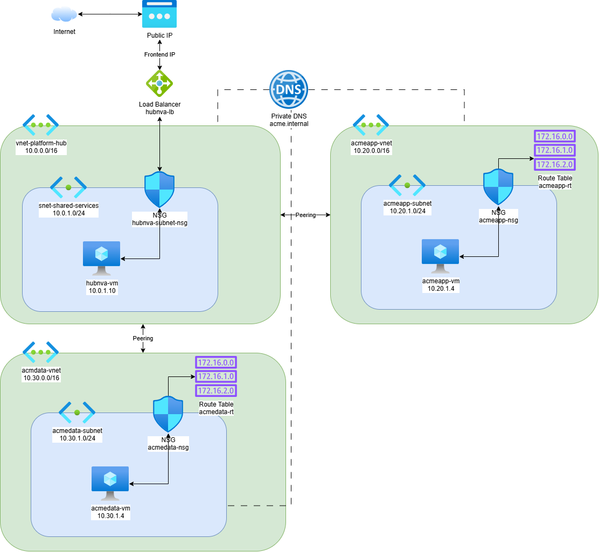

# acme-UbuntuNVA-Project

## Project design:



## Network Rules Summary

### Hub NSG 

Attached to the hub subnet (`10.0.1.0/24`).

| Rule | Priority | Direction | Access | Protocol | Source | Destination | Dest. Port |
|---|---|---|---|---|---|---|---|
| Allow-App-To-Data-In | 500 | Inbound | Allow | * | 10.20.1.0/24 | 10.30.1.0/24 | * |
| Allow-Data-To-App-In | 550 | Inbound | Allow | * | 10.30.1.0/24 | 10.20.1.0/24 | * |
| Allow-App-Internet-In | 600 | Inbound | Allow | * | 10.20.1.0/24 | Internet | * |
| Allow-Data-Internet-In | 650 | Inbound | Allow | * | 10.30.1.0/24 | Internet | * |
| Allow-App-To-Data-Out | 500 | Outbound | Allow | * | 10.20.1.0/24 | 10.30.1.0/24 | * |
| Allow-Data-To-App-Out | 550 | Outbound | Allow | * | 10.30.1.0/24 | 10.20.1.0/24 | * |
| Allow-App-Internet-Out | 600 | Outbound | Allow | * | 10.20.1.0/24 | Internet | * |
| Allow-Data-Internet-Out | 650 | Outbound | Allow | * | 10.30.1.0/24 | Internet | * |
| Allow-NVA-Internet-Out | 700 | Outbound | Allow | * | 10.0.1.10 | Internet | * |

### Data NSG

Attached to the Data spoke subnet (`10.30.1.0/24`).

| Rule | Priority | Direction | Access | Protocol | Source | Destination | Dest. Port |
|---|---|---|---|---|---|---|---|
| Allow-Data-From-App | 500 | Inbound | Allow | TCP | 10.20.1.0/24 | 10.30.1.0/24 | 80 |
| Allow-ICMP-From-App | 550 | Inbound | Allow | ICMP | 10.20.1.0/24 | 10.30.1.0/24 | * |
| Allow-ICMP-To-App | 500 | Outbound | Allow | ICMP | 10.30.1.0/24 | 10.20.1.0/24 | * |
| Deny-Outbound-To-App | 550 | Outbound | **Deny** | * | 10.30.1.0/24 | 10.20.1.0/24 | * |

### App NSG 

Attached to the App spoke subnet (`10.20.1.0/24`).

| Rule | Priority | Direction | Access | Protocol | Source | Destination | Dest. Port |
|---|---|---|---|---|---|---|---|
| Allow-ICMP-From-Data | 500 | Inbound | Allow | ICMP | 10.30.1.0/24 | 10.20.1.0/24 | * |
| Deny-Inbound-From-Data | 550 | Inbound | **Deny** | * | 10.30.1.0/24 | 10.20.1.0/24 | * |
| Allow-ICMP-To-Data | 500 | Outbound | Allow | ICMP | 10.20.1.0/24 | 10.30.1.0/24 | * |

### Data Route Table

Associated with the Data spoke subnet.

| Route | Address Prefix | Next Hop Type | Next Hop IP |
|---|---|---|---|
| toInternet | 0.0.0.0/0 | VirtualAppliance | 10.0.1.10 |
| toAppVnet | 10.20.1.0/24 | VirtualAppliance | 10.0.1.10 |

### App Route Table

Associated with the App spoke subnet.

| Route | Address Prefix | Next Hop Type | Next Hop IP |
|---|---|---|---|
| toInternet | 0.0.0.0/0 | VirtualAppliance | 10.0.1.10 |
| toDataVnet | 10.30.1.0/24 | VirtualAppliance | 10.0.1.10 |

## Configure AZ with Service Principal

- Generate Certificate:
	- 1. Generate a private key and a public self-signed certificate (valid for 365 days) running: $> openssl req -x509 -newkey rsa:2048 -keyout privkey.pem -out pubcert.pem -days 365 -nodes
	- 2. Combine them into a single file for az login with: $> cat privkey.pem pubcert.pem > mycert.pem
	- 3. Secure your private key file permissions with: $> chmod 600 mycert.pem privkey.pem
- Upload public certificate pubcert.pem file to Azure App Registration Certificates
- Use certificate mycert.pem file to login:
```sh
az login --service-principal \
  --username "<CLIENT_ID>" \
  --certificate ~/.az/mycert.pem \
  --tenant "<TENANT_ID>"
```

## Deploying:

- on the project's root folder execute each command one-by-one after terraform init for each one:
- OBS: acme-data-rg must be the last one. it needs the hub to have internet access and instal its web server.
```sh
terraform -chdir="acme-hub-rg" apply -auto-approve
terraform -chdir="acme-app-rg" apply -auto-approve
terraform -chdir="acme-data-rg" apply -auto-approve
```

## Design text

Azure network infrastructure:
- VNET: vnet-platform-hub
	- SUBNET: snet-shared-services (CIDR: 10.0.1.0/24)
		- subnet has NSG hubnva-subnet-nsg
			- Internet egress Rule: Allow Source Any, Destination service tag: internet
		- contains VM "hubnva-vm" with fixed private IP 10.0.1.10
			- NIC with ip_forwarding_enabled = true
		
- VNET: acmeapp-vnet
	- VNET is peered to vnet-platform-hub and both sides have "receive forwarding traffic" enabled
	- SUBNET: acmeapp-subnet (CIDR: 10.20.1.0/24)
		- subnet has NSG acmeapp-nsg with only default rules
		- contains VM "acmeapp-vm" with dynamic private IP 10.20.1.4
	- ROUTE TABLE: acmeapp-rt with rules:
		- toDataVnet : 10.30.1.0/24 to 10.0.1.10
		- toInternet: 0.0.0.0/0 to 10.0.1.10
	
- VNET: acmedata-vnet
	- VNET is peered to vnet-platform-hub and both sides have "receive forwarding traffic" enabled
	- SUBNET: acmedata-subnet (CIDR: 10.30.1.0/24)
		- subnet has NSG acmedata-nsg with only default rules
		- contains VM "acmedata-vm" with dynamic private IP 10.30.1.4
	- ROUTE TABLE: acmedata-rt with rules:
		- toAppVnet : 10.20.1.0/24 to 10.0.1.10
		- toInternet: 0.0.0.0/0 to 10.0.1.10
		
- PUBLIC LOAD BALANCER: hubnva-lb	
	- Frontend IP Configuration: Public IP "hubnva-pip" with IP 20.97.116.99
	- Backend Pools: hubnva-backend-pool containing vm hubnva-vm with IP 10.0.1.10
	- Health probes: none created
	- Load balancing rules: none created
	- Outbound rules: hubnva-outbound configured:
		- Frontend IP address: public PIP (hubnva-pip)
		- Protocol: All
		- Backend Pool: hubnva-backend-pool


## TODO
- add private DNS for VM names resolution
